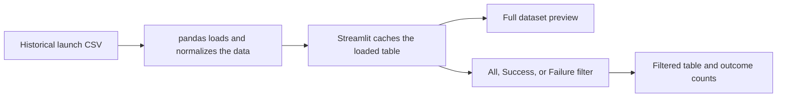

# SpaceX Launch Dashboard

A small Streamlit dashboard for exploring historical SpaceX launches. Pick an outcome to filter the records and see success and failure counts for the current selection.

## Architecture



[app.py](app.py) contains the interface and filtering logic. The [bundled CSV](spacex_launch_data_fixed.csv) supplies launch dates, sites, payloads, and outcomes. The filter uses the dataset's binary `Success` field for the mission outcome. Landing outcome is a separate column. The dashboard uses a historical snapshot and has no external API dependency.

## Run locally

From the repository root, use Python 3 and create a fresh environment.

```sh
python -m venv .venv
# Windows PowerShell: .venv\Scripts\Activate.ps1
# macOS/Linux: source .venv/bin/activate
python -m pip install streamlit pandas
python -m streamlit run app.py
```

Open the URL printed by Streamlit. Try **All**, **Success**, and **Failure** in the sidebar and compare the table with the outcome counts. Keep the CSV beside `app.py` and start Streamlit from the repository root.
